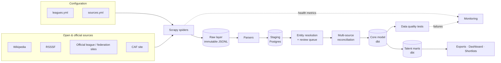
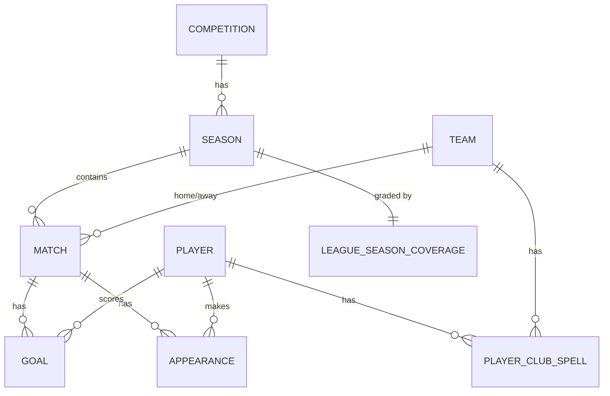

# African Football Talent Data Platform — Architecture

**Version:** 1.0 (scraping-first)
**Scope:** Major CAF leagues + Kenya, collecting only the data needed for talent identification.
**Approach:** Scrape open and official sources now; keep the design ready to plug in a paid API later without rewrites.

---

## 1. Purpose

Build a continental dataset of African domestic league football that lets a scout answer one question well:

> *Which young players in African leagues are getting real minutes, producing, and improving — and how do they compare across leagues?*

Everything in this architecture is judged against that question. If a field does not help answer it, we do not collect it.

---

## 2. Design principles

1. **Collect only what is necessary.** A fixed data contract (Section 4) defines every field we store. Anything outside it is not scraped.
2. **Raw is immutable.** Every scrape is saved untouched. All fixes happen in parsing or transformation, so we can always reprocess.
3. **Every value knows its source.** `source_id` and `source_url` travel with each record from raw to core.
4. **We own the IDs.** Teams and players get internal stable IDs. Source names and IDs are only aliases.
5. **Config over code.** Leagues and sources are defined in YAML. Adding a league = adding config + (if needed) one parser.
6. **Honest completeness.** Every league-season carries a data tier (A/B/C). Metrics are only computed where the data supports them.
7. **Polite and lawful scraping.** Obey robots.txt, respect terms of service, throttle, cache, identify ourselves.
8. **Personal data minimisation.** Only public sporting information about players. No contact details, addresses, photos, or social profiles.

---

## 3. League scope and rollout

The core list follows CAF's 5-year association ranking (the 12 associations allowed two clubs in CAF club competitions), plus Kenya as a project priority and Ghana/Zambia as key player-export markets.

| Wave | Leagues | Why this wave |
|---|---|---|
| 1 | South Africa, Egypt, Morocco, Tanzania, Kenya | One well-covered league (RSA), Arabic and French sources, East African coverage, one thin league — exposes every hard problem early |
| 2 | Algeria, Tunisia, Nigeria, Ivory Coast, Ghana | Strong leagues, French/Arabic/English mix |
| 3 | DR Congo, Angola, Mali, Sudan, Zambia (+ others) | Thinner or more irregular coverage |
| Always | CAF Champions League, CAF Confederation Cup | Only matches where clubs from different leagues meet — required for league strength |

A wave starts only when the previous wave's leagues pass all quality checks for the current season.

---

## 4. Data contract — the only data we collect

### 4.1 Entities and fields

Priority: **M** = must have (pipeline fails without it), **S** = should have (collected where available), **L** = later.

| Entity | Field | Priority | Used for |
|---|---|---|---|
| Competition | name, country, type (league/cup/continental) | M | Scoping |
| Season | label, start_date, end_date | M | Age at season, ordering |
| Team | name, country | M | Everything |
| Match | date, home team, away team, home goals, away goals, status (played/postponed/abandoned/awarded), round | M | Results, team strength, minutes denominators |
| Goal | match, scorer, team, minute, type (open play / penalty / own goal) | M | Output metrics |
| Player | full name, date of birth, nationality, primary position | M (DOB), S (others) | Age, grouping |
| Appearance | match, player, team, started (y/n), minute on, minute off | S | Minutes, starts share — the key talent signal |
| Assist | goal, assisting player | S | Output metrics |
| Card | match, player, minute, colour | L | Discipline flags |
| Squad listing | season, team, player, shirt number | S | Player–club linkage when lineups are missing |
| Transfer / move | player, from team, to team, date | S (derived) | Career paths, backtest outcomes |

### 4.2 Explicitly excluded

We do **not** collect: betting odds, market values, injury records, xG or event coordinates, tracking data, player photos, agent details, salaries, contact details, social media handles, or any data about players' private lives.

### 4.3 Personal data and minors

Talent data often concerns players aged 16–21, some of them minors. Rules:

- Store only public sporting facts (name, DOB, nationality, position, matches played).
- Never publish a player's full DOB in public exports — publish birth year or age band only. Full DOB stays internal for age calculations.
- Keep a documented legal basis and retention policy, and follow applicable data protection law in each country of operation (e.g. South Africa's POPIA, Kenya's Data Protection Act 2019). Get local legal advice before commercialising.
- Honour takedown/correction requests through a documented process.

---

## 5. Data tiers (per league-season)

Because we rely on scraping, coverage will differ by league and by season. Each league-season is assigned a tier automatically by the coverage job (Section 7.9).

| Tier | Data available | Talent metrics possible |
|---|---|---|
| **A** | Results + scorers + lineups with substitution minutes | Minutes, minutes share, starts share, goals & assists per 90, full talent score |
| **B** | Results + scorers (+ squad lists) | Appearances (if listed), goals per appearance, age, club path — reduced talent score |
| **C** | Results only | Team strength and league context only — no player scoring |

The tier is stored in `core.league_season_coverage` and shown next to every metric in outputs.

---

## 6. High-level architecture



| Layer | Technology | Responsibility |
|---|---|---|
| Configuration | YAML in repo | Which leagues, which sources, how to reach them |
| Ingestion | Scrapy (+ scrapy-playwright only when unavoidable) | Fetch pages politely, emit raw items |
| Raw | Local disk → S3/GCS later, JSONL | Immutable record of every scrape |
| Parsing | Python parsers per source | Turn raw HTML-derived items into typed staging rows |
| Staging | PostgreSQL | Typed, source-specific tables |
| Entity resolution | Python + dbt seeds | Map every name to internal team/player IDs |
| Reconciliation | dbt | Choose the best value when sources disagree |
| Core | dbt on PostgreSQL | Clean, source-agnostic model |
| Marts | dbt | Talent metrics, league strength, shortlists |
| Orchestration | Dagster | Partitioned runs (league × season), schedules, lineage |
| Serving | CSV/Parquet exports, Streamlit or Metabase | Scouts and analysts |

---

## 7. Components

### 7.1 League registry — `config/leagues.yml`

```yaml
leagues:
  - league_id: RSA_PREM
    name: South African Premiership
    country: South Africa
    wave: 1
    language: en
    season_format: aug_may          # aug_may | calendar | irregular
    seasons: ["2021-22", "2022-23", "2023-24", "2024-25", "2025-26", "2026-27"]
    sources: [wikipedia_season, rsssf_tables, psl_official]

  - league_id: KEN_PL
    name: Kenyan Premier League
    country: Kenya
    wave: 1
    language: en
    season_format: tbd              # confirm during source audit
    seasons: []                     # fill after source audit
    sources: [wikipedia_season, rsssf_tables]   # + official source once audited

  - league_id: EGY_PL
    name: Egyptian Premier League
    country: Egypt
    wave: 1
    language: ar
    season_format: tbd
    seasons: []
    sources: [wikipedia_season, rsssf_tables]

  - league_id: CAF_CL
    name: CAF Champions League
    country: Africa
    type: continental
    wave: 1
    language: en
    season_format: irregular
    seasons: ["2021-22", "2022-23", "2023-24", "2024-25", "2025-26", "2026-27"]
    sources: [wikipedia_season, caf_official]
```

Seasons are stored with real start/end dates in `core.season`; labels are display-only.

### 7.2 Source registry — `config/sources.yml`

Every source must pass a review before a spider is written for it.

```yaml
sources:
  - source_id: wikipedia_season
    base_url: https://en.wikipedia.org
    kind: html
    provides: [matches, standings, top_scorers, squads]
    licence: CC BY-SA (attribution required)
    robots_checked: true
    tos_reviewed: true
    allowed: true
    priority: 2                     # lower number wins in reconciliation
    rate_limit_seconds: 1.0

  - source_id: rsssf_tables
    base_url: https://rsssf.org
    kind: text_html
    provides: [matches, standings, top_scorers]
    licence: Free to copy with acknowledgement of RSSSF
    robots_checked: true
    tos_reviewed: true
    allowed: true
    priority: 3
    rate_limit_seconds: 2.0

  - source_id: psl_official
    base_url: https://www.psl.co.za
    kind: html
    provides: [matches, match_reports, lineups, scorers]
    licence: Official league site — check terms
    robots_checked: false           # must be true before first run
    tos_reviewed: false
    allowed: false                  # flipped to true after review
    priority: 1
    rate_limit_seconds: 2.0

  - source_id: caf_official
    base_url: https://www.cafonline.com
    kind: html
    provides: [matches, standings]
    licence: Official — check terms
    robots_checked: false
    tos_reviewed: false
    allowed: false
    priority: 1
    rate_limit_seconds: 2.0
```

**Rule enforced in code:** spiders refuse to start if their source has `allowed: false`.

**Commercial aggregators** (score sites, market-value sites) are **not** in the registry. Their terms generally restrict automated collection. They may be used manually by a human to verify suspicious records, never as automated inputs.

### 7.3 Source audit (per new league)

Before adding a league, complete an audit spreadsheet (`docs/source_audit/<league_id>.csv`):

| Column | Example |
|---|---|
| source | Wikipedia season page |
| url_pattern | `/wiki/<season>_<League_name>` |
| data_types | results, table, top scorers |
| seasons_available | 2015-16 → current |
| update_frequency | weekly, volunteer-edited |
| structured? | HTML tables |
| language | en |
| robots / ToS | allowed |
| reliability notes | scorer names sometimes missing |

The audit decides the league's source list and expected tier.

### 7.4 Ingestion — Scrapy project

```
ingestion/
├── scrapy.cfg
└── ingestion/
    ├── settings.py
    ├── items.py              # RawPageItem schema
    ├── registry.py           # loads leagues.yml + sources.yml, enforces allowed flag
    ├── pipelines.py          # ValidateItemPipeline, RawWriterPipeline, RunStatsPipeline
    ├── middlewares.py
    └── spiders/
        ├── base.py           # RegistrySpider: common start_requests, league/season args
        ├── wikipedia_season.py
        ├── rsssf_tables.py
        ├── psl_official.py
        └── caf_official.py
```

**Spider contract.** Every spider:

- Takes `league_id` and `season` arguments (so Dagster can run one partition at a time).
- Emits one generic item per extracted block (table, match report, squad list) — **no business logic in spiders**.
- Never parses deeply; it captures structure (rows, cells, links, headings) and leaves meaning to parsers.

**Raw item schema (`items.py`):**

| Field | Description |
|---|---|
| run_id | UUID of the scrape run |
| source_id | From sources.yml |
| league_id, season | Partition keys |
| url | Page URL |
| block_type | `table`, `match_report`, `squad`, `text` |
| block_index | Position on page |
| section | Nearest heading |
| payload | Rows/cells/links as extracted |
| http_status, fetched_at | Fetch metadata |
| content_hash | Hash of payload — detects unchanged pages |

**Settings (key values):**

```python
ROBOTSTXT_OBEY = True
USER_AGENT = "AfricanFootballData/1.0 (+<repo-url>; <contact-email>)"
AUTOTHROTTLE_ENABLED = True
DOWNLOAD_DELAY = 1.0              # overridden per source from sources.yml
CONCURRENT_REQUESTS_PER_DOMAIN = 1
HTTPCACHE_ENABLED = True          # dev only; disabled in scheduled runs
RETRY_TIMES = 3
```

**JavaScript-rendered pages.** First look for the JSON endpoint the page calls (browser dev tools → Network) and request that directly. Use `scrapy-playwright` only for that specific spider if no endpoint exists, and only for allowed sources.

### 7.5 Raw layer

Layout (Hive-style partitions so it maps cleanly to S3/GCS later):

```
data/raw/
  source=wikipedia_season/
    league=RSA_PREM/
      season=2025-26/
        run=2026-09-21T06-00-00Z_<run_id>.jsonl
  _manifests/
    <run_id>.json           # items count, errors, duration, pages fetched
```

Rules: files are append-only and never edited; retention is indefinite for raw; `content_hash` lets parsers skip unchanged pages.

### 7.6 Parsing and staging

One parser module per source, each producing typed rows into source-specific staging tables:

```
parsers/
├── common/
│   ├── text.py          # footnote stripping, dash normalisation, whitespace
│   ├── names.py         # transliteration + normalisation helpers
│   └── dates.py         # multilingual date parsing
├── wikipedia_season.py  # results matrix, league table, top scorers, squads
├── rsssf_tables.py      # fixed-width text tables and result lists
├── psl_official.py      # match reports → lineups, subs, goals
└── caf_official.py
```

Staging tables (schema `staging`) keep the source's raw names:

| Table | Grain |
|---|---|
| `stg_match` | source × match |
| `stg_goal` | source × goal |
| `stg_appearance` | source × match × player |
| `stg_squad` | source × season × team × player |
| `stg_player_profile` | source × player (name, DOB, nationality, position) |
| `stg_standing` | source × season × team (used for validation only) |

Every staging row carries `source_id`, `source_url`, `run_id`, `league_id`, `season`.

**Parser failure policy:** if a page's structure doesn't match expectations, the parser writes the block to `staging.parse_failures` with the reason, and the partition is marked incomplete. It never guesses.

### 7.7 Entity resolution

The hardest and most valuable component.

**Teams.** Maintained in `seeds/team.csv` and `seeds/team_alias.csv` (alias, source_id, team_id, valid_from, valid_to). Validity dates handle renames and franchise sales. Any unmapped team name fails the dbt build.

**Players.** Names appear in English, French and Arabic transliterations, with nicknames and inconsistent ordering. Matching pipeline:

1. **Normalise** — lowercase, strip accents, unify transliteration variants (e.g. `Mohamed/Mohammed/Muhammad`, `El/Al`), sort name tokens.
2. **Block** — only compare candidates that share a club-season, or share a DOB, or share a normalised surname.
3. **Score** — combine: name similarity (token-based), DOB match (exact / year-only / conflict), same club in same season, nationality match.
4. **Decide:**
   - score ≥ high threshold and no DOB conflict → auto-link to existing `player_id`
   - score in grey zone → `review_queue` for a human
   - no candidate → new `player_id`
5. **Record** every decision in `player_alias` with method (`auto`, `manual`), score and timestamp. Manual decisions are never overwritten by automatic runs.

**Birth date confidence.** Age drives talent scoring, and age discrepancies are a known issue in the game. Each player gets `dob_confidence`:

| Value | Rule |
|---|---|
| high | Same DOB from 2+ independent sources |
| medium | One source, no conflict |
| low | Sources disagree, or year only |
| unknown | No DOB found — player excluded from age-based rankings |

### 7.8 Multi-source reconciliation

When sources disagree, dbt models pick a value using, in order:

1. Manual override (`seeds/overrides.csv`) — always wins.
2. Source `priority` from `sources.yml` (official > Wikipedia > RSSSF).
3. Most recent scrape.

Every disagreement is written to `core.conflict_log` (entity, field, values per source, chosen value, rule applied). Conflicts above a threshold per league-season raise an alert.

### 7.9 Coverage and tiering job

After each run, a dbt model computes per league-season:

- % of matches with a result
- % of goals with a named scorer
- % of matches with lineups
- % of appearances with minute data
- % of players with DOB

Tier assignment:

- **A**: results ≥ 98%, scorers ≥ 90%, lineups with minutes ≥ 80%
- **B**: results ≥ 98%, scorers ≥ 80%
- **C**: otherwise

Stored in `core.league_season_coverage` and exposed everywhere metrics are shown.

### 7.10 Core model (dbt, schema `core`)



| Table | Key columns |
|---|---|
| `competition` | competition_id, name, country, type |
| `season` | season_id, competition_id, label, start_date, end_date |
| `team` | team_id, name, country |
| `player` | player_id, display_name, dob, dob_confidence, nationality, primary_position |
| `match` | match_id, season_id, date, home_team_id, away_team_id, home_goals, away_goals, status, round, source_id |
| `goal` | goal_id, match_id, player_id, team_id, minute, goal_type, assist_player_id |
| `appearance` | match_id, player_id, team_id, started, minute_on, minute_off, minutes_played |
| `player_club_spell` | player_id, team_id, first_seen, last_seen (derived from appearances/squads) |
| `league_season_coverage` | season_id, tier, coverage percentages |
| `conflict_log` | entity, entity_id, field, source_values, chosen_value, rule |

### 7.11 Data quality tests

| Test | Level |
|---|---|
| Every match has two different teams | error |
| No team plays twice on the same date in the same competition | error |
| Match count per season equals expected (n × (n−1) for double round-robin, else from config) | error |
| Goals in `goal` table per match equal the match score (Tier A/B) | warn |
| Computed standings equal the published table (from staging) | error |
| Every team/player name resolves to an ID | error |
| `minutes_played` between 0 and 120 | error |
| Team minutes per match ≈ 990 (Tier A) | warn |
| Player not on two teams in one match | error |
| Player DOB implies age between 14 and 45 at match date | warn |
| Spider returned 0 items for a partition that previously had data | error (layout change) |

### 7.12 League strength

Needed to compare a goal in Egypt with a goal in Kenya.

- **Association coefficient:** scrape the CAF 5-year ranking (from its public Wikipedia page), store per association per season.
- **Direct evidence:** results of CAF Champions League and Confederation Cup matches between clubs from different leagues, modelled as an Elo-style rating per club, aggregated to league level.
- **Output:** `mart.league_strength` (league_id, season_id, coefficient, normalised 0–1 strength).

### 7.13 Talent marts (dbt, schema `mart`)

| Model | Contents | Tiers |
|---|---|---|
| `player_season` | appearances, starts, minutes, goals, assists, per-90 rates, minutes share, starts share, age at season midpoint | A (full), B (reduced) |
| `team_season_strength` | points per game, goal difference per game, final position | A, B, C |
| `player_percentiles` | per-metric percentiles vs same position & season; within-league and strength-adjusted continental | A, B |
| `player_progression` | season-over-season change in minutes share and output | A, B |
| `player_career_path` | ordered club spells across leagues | A, B |
| `talent_score` | transparent weighted blend (see below) | A, B |
| `shortlist` | filterable view: position, max age, min minutes, league, tier, dob_confidence | A, B |

**Talent score v1 (transparent weights, tunable in `seeds/talent_weights.csv`):**

| Component | Tier A weight | Tier B weight |
|---|---|---|
| Minutes share (age-adjusted) | 0.35 | — |
| Appearances share (age-adjusted) | — | 0.35 |
| Output percentile (goals+assists per 90 / per app) | 0.25 | 0.30 |
| Progression (YoY) | 0.20 | 0.20 |
| Team strength context | 0.10 | 0.10 |
| League strength | 0.10 | 0.05 |

Minimum thresholds: 900 minutes (Tier A) or 10 appearances (Tier B); `dob_confidence` ≠ unknown.

**Backtest (credibility check):** `mart.backtest_outcomes` labels players who later moved to a stronger league, earned a national team cap, or became regular starters at a top-3 club. Measure how many ranked in the top 10% of the talent score at age ≤ 21. Publish the hit rate with each release.

### 7.14 Orchestration — Dagster

- **Partitions:** multi-dimensional `league_id × season`, generated from `leagues.yml`.
- **Asset graph:** `raw_pages → staging_tables → entity_resolution → core (dbt) → coverage → marts (dbt)`.
- **Schedules:**
  - Current season: weekly (Monday 06:00 EAT) for all active leagues, plus a midweek run in busy periods.
  - Historical backfill: manual, one partition at a time, throttled.
  - League strength: after each CAF competition round.
- **Sensors:** new `review_queue` items → notify; failed quality tests → notify.
- **Freshness policy:** current-season partitions must be updated within 8 days.

### 7.15 Monitoring

Tracked per run from the manifests and dbt results:

- pages fetched, items emitted, HTTP errors, retries, duration
- items vs previous run for the same partition (sudden drop = layout change)
- parse failures per source
- review queue size
- conflicts per league-season
- coverage tier changes

Start with a Dagster UI + a simple `monitoring` dashboard in Metabase/Streamlit; add alerting (email/Slack) once running on a schedule.

### 7.16 Serving

- **Internal:** Postgres views over `mart.*`, a Streamlit/Metabase shortlist dashboard.
- **Public (optional):** versioned CSV/Parquet exports per release with attribution (Wikipedia CC BY-SA, RSSSF acknowledgement), birth year only for players, and the coverage tier per league-season.

---

## 8. Repository structure

```
african-football-data/
├── config/
│   ├── leagues.yml
│   └── sources.yml
├── docs/
│   ├── architecture.md          # this file
│   └── source_audit/
├── ingestion/                   # Scrapy (7.4)
├── parsers/                     # 7.6
├── entity_resolution/           # 7.7
├── transform/                   # dbt: staging → core → mart
│   ├── seeds/                   # teams, aliases, overrides, talent_weights
│   ├── models/{staging,core,mart}
│   └── tests/
├── orchestration/               # Dagster definitions
├── serving/                     # dashboard + export scripts
├── data/raw/                    # git-ignored
├── docker-compose.yml           # Postgres (+ Dagster, Metabase later)
└── README.md
```

---

## 9. Technology stack

| Concern | Choice | Notes |
|---|---|---|
| Language | Python 3.11+ | |
| Scraping | Scrapy; scrapy-playwright only if unavoidable | |
| Storage | PostgreSQL 16; local disk → S3/GCS for raw | Postgres is enough for millions of appearance rows |
| Transformation | dbt-postgres | |
| Orchestration | Dagster | Partitions fit league × season naturally |
| Entity resolution | Python (rapidfuzz, unidecode) | |
| Serving | Streamlit or Metabase; Parquet exports | |
| Infra | Docker Compose locally → single small VM later | |

---

## 10. Scraping etiquette and compliance checklist

Before a source goes live:

- [ ] robots.txt allows the paths we fetch
- [ ] Terms of service reviewed and recorded in `sources.yml`
- [ ] Rate limit set (≥ 1 s between requests per domain)
- [ ] User agent identifies the project and a contact address
- [ ] Only fields in the data contract are extracted
- [ ] Licence/attribution requirements recorded and applied to exports
- [ ] Caching enabled during development to avoid repeat requests

---

## 11. Roadmap

| Phase | Weeks | Deliverables | Exit criteria |
|---|---|---|---|
| 0. Foundations | 1–2 | Repo, Docker, registries, base spider, raw layer, Dagster skeleton | One partition runs end-to-end |
| 1. RSA pilot | 3–5 | Wikipedia + RSSSF spiders/parsers, team resolution, core matches, standings, quality tests | 5 seasons of RSA match data pass all error-level tests |
| 2. Players (RSA) | 6–8 | Scorers, squads, official match reports (after ToS review), player resolution, DOB confidence | Tier assigned; review queue workflow working |
| 3. Wave 1 | 9–13 | Egypt, Morocco, Tanzania, Kenya source audits → spiders → parsers; multilingual name handling | All Wave 1 current seasons at least Tier C, most Tier B |
| 4. Talent v1 | 14–16 | Player marts, percentiles, talent score, shortlist dashboard | Shortlist usable by a scout for Wave 1 leagues |
| 5. League strength + backtest | 17–19 | CAF competitions ingestion, strength model, backtest | Published hit rate |
| 6. Waves 2–3 | 20+ | Remaining leagues | Each league passes the same checks |

---

## 12. Upgrade path

The architecture is source-agnostic by design:

- A paid API (or a data partnership with a league/federation) becomes **one more entry in `sources.yml`** with its own spider/loader and parser writing to the same staging tables.
- Give it a higher `priority` and reconciliation automatically prefers it.
- Tiers upgrade automatically as coverage improves.
- Raw scraped data stays for audit and for seasons the API doesn't cover.

No downstream model (core, marts, dashboard) changes.
